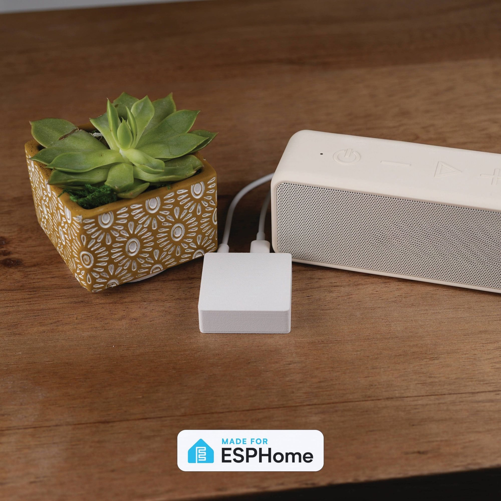

# Apollo CAST-1

<p align="center">
  
</p>

Easily make your speakers smart and cast to multiple devices using Music Assistant and Sendspin!

## Connectivity

One firmware covers both WiFi and Ethernet — there is no need to pick a
variant or reflash to switch:

- **Ethernet plugged in:** traffic moves to Ethernet. If the device is also
  joined to your WiFi, that connection stays up alongside, so Home Assistant
  never loses the device when you plug or unplug the cable. If WiFi has no
  network to join, it turns off entirely — the setup hotspot is never active
  while Ethernet is connected.
- **No Ethernet:** WiFi works as usual. The device rejoins its saved
  network, or opens the "Apollo CAST 1 Hotspot" for setup if none is
  configured (Improv via Bluetooth or USB works too).

Use the on-device **Network Connection** sensor (Diagnostics) to see which
connection is active at a glance.

## WizMote

The CAST-1 gives you full Home Assistant control over a paired Wiz WizMote. Each of the nine buttons (On, Off, Night, Brightness Up/Down, and 1–4) is a configurable select on the device — assign it Play, Pause, Play / Pause, Next/Previous Track, Volume Up/Down, Toggle Light, or Send HA Event. The defaults give you media controls out of the box.

Set any button to **Send HA Event** to trigger a custom Home Assistant action — play a Music Assistant playlist, toggle a room's lights, run a scene or script.

Configure every button without leaving Home Assistant using the [CAST-1 WizMote blueprint](https://github.com/ApolloAutomation/Blueprints/tree/main/CAST-1):

[](https://my.home-assistant.io/redirect/blueprint_import/?blueprint_url=https%3A%2F%2Fgithub.com%2FApolloAutomation%2FBlueprints%2Fblob%2Fmain%2FCAST-1%2FCAST-1-WizMote.yaml)

## Announcements

While an announcement plays, music ducks and the onboard LED lights up. Change either in your device YAML in ESPHome Device Builder, then install:

```yaml
substitutions:
  announcement_ducking_db: "20"         # how far music drops, in dB (default 40; 0 = no ducking)
  announcement_led_brightness: "25%"    # onboard LED brightness during announcements (default 50%)
```

## External LED Strip

The 5V / GND / IO1 header drives an addressable LED strip (WS2812, SK6812, WS2811, APA106 or SM16703). The strip is opt-in: add `led_strip.yaml` to the packages in your device YAML in ESPHome Device Builder, set how many LEDs it has (the default is 30), then install:

```yaml
substitutions:
  led_strip_num_leds: "21"

packages:
  cast_1: github://ApolloAutomation/CAST-1/Integrations/ESPHome/CAST-1.yaml@main
  led_strip: github://ApolloAutomation/CAST-1/Integrations/ESPHome/led_strip.yaml@main
```

Remove the `led_strip` line to drop the strip again. Any partitions you added have to go with it, since they use the strip.

The rest of the strip's settings live in Home Assistant and under **External LED Strip** on the device's web page:

- **Chipset**, **Color Order** and **Max Brightness** describe your strip.
- **Effect A** and **Effect B** are two effect slots. Each has a **Pattern** (Flicker or Strobe) and a **Speed** (1 = one change per second, 100 = one every 32 ms, on a log curve). Flicker dips to random levels between full and 30% brightness; Strobe is on for one period and off for the next. Changes apply live while the effect runs.

In automations, set the pattern and speed with `select.select_option` and `number.set_value`, then call `light.turn_on` with `effect: "Effect A"` (add `transition: 0` for an instant start).

### Splitting the strip into segments

To turn parts of the strip on and off on their own, add [partition lights](https://esphome.io/components/light/partition/) to your device YAML in ESPHome Device Builder and install it. Each partition becomes its own light in Home Assistant, with its own on/off, color, brightness and effect. List Effect A and Effect B on a partition to use the shared Pattern and Speed settings.

For 21 LEDs in 3 segments of 7 (`to` is inclusive, and the first LED is 0):

```yaml
light:
  - platform: partition
    name: "LED Segment 1"
    segments:
      - id: led_strip
        from: 0
        to: 6
    default_transition_length: 0s
    effects: &led_segment_effects
      - addressable_lambda:
          name: "Effect A"
          update_interval: 15ms
          lambda: "id(led_strip_slot_effect)(it, current_color, initial_run, 0);"
      - addressable_lambda:
          name: "Effect B"
          update_interval: 15ms
          lambda: "id(led_strip_slot_effect)(it, current_color, initial_run, 1);"
  - platform: partition
    name: "LED Segment 2"
    segments:
      - id: led_strip
        from: 7
        to: 13
    default_transition_length: 0s
    effects: *led_segment_effects
  - platform: partition
    name: "LED Segment 3"
    segments:
      - id: led_strip
        from: 14
        to: 20
    default_transition_length: 0s
    effects: *led_segment_effects
```

Every partition has to fit inside `led_strip_num_leds`; the install fails if one doesn't. Partitions share the strip's pixels, so control either the partitions or the main **LED Strip** light, not both at once — turning the main light off clears the whole strip.

> [!WARNING]
> **Photosensitivity:** Strobe flashes faster than 3 times per second from about Speed 50 up, and reaches about 16 flashes per second at Speed 100. Flashing in this range can trigger seizures in people with photosensitive epilepsy.

Power long strips from their own 5V supply with a shared ground; the header can't supply a full-brightness strip, and **LED Strip Max Brightness** (default 50%) caps the draw.

Links: \
Discord (Support/feedback/discussion/future products): [http://dsc.gg/ApolloAutomation](http://dsc.gg/ApolloAutomation) \
Shop: [https://apolloautomation.com](https://apolloautomation.com) \
Wiki: [https://wiki.apolloautomation.com](https://wiki.apolloautomation.com/)
